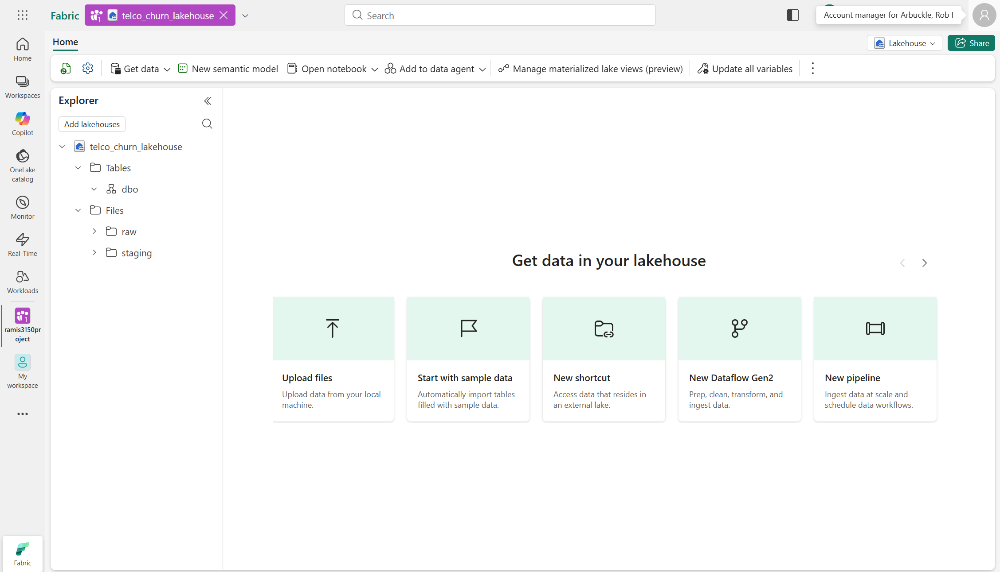
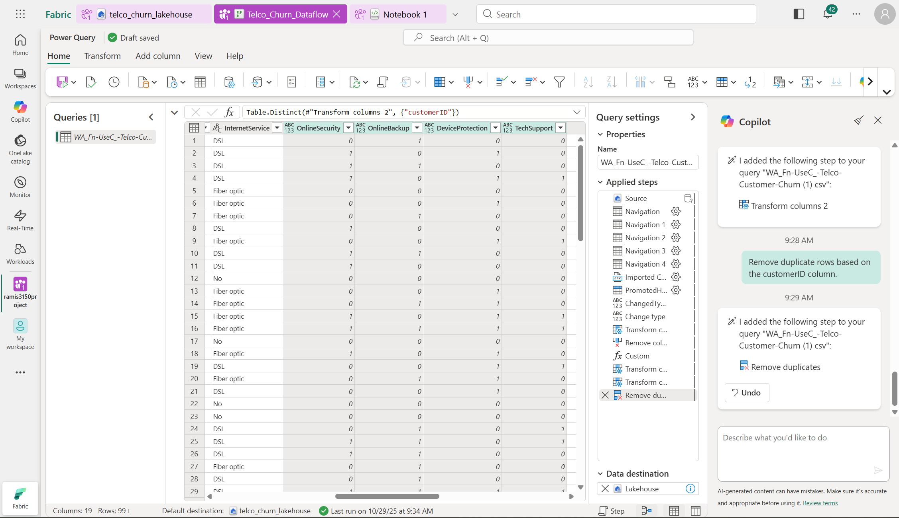
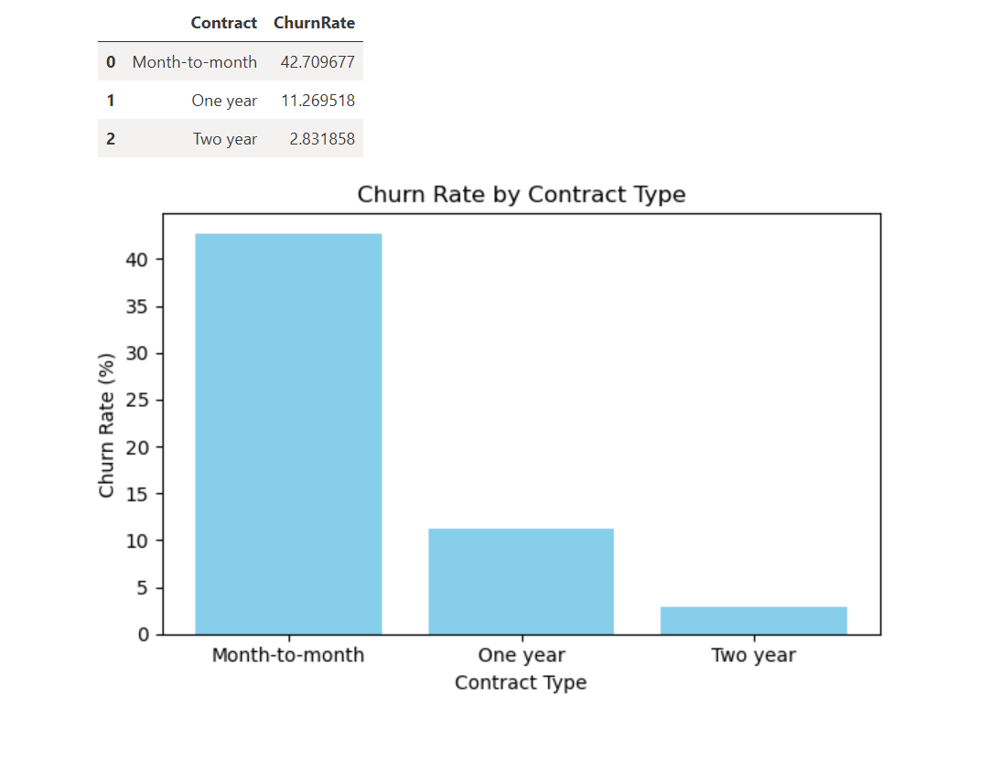
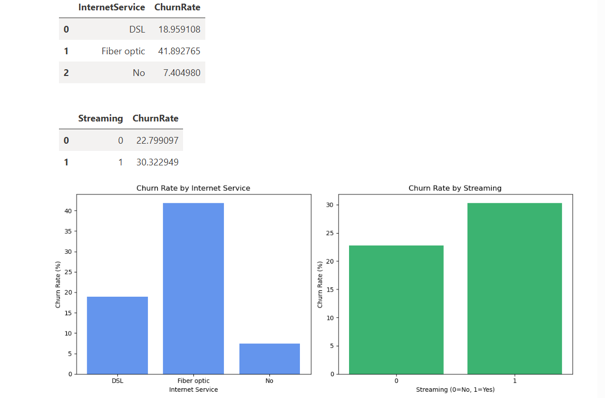
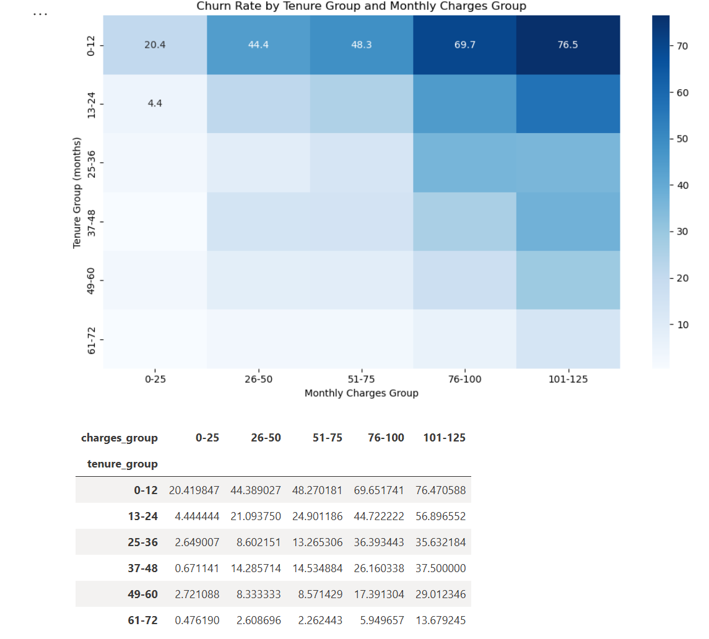
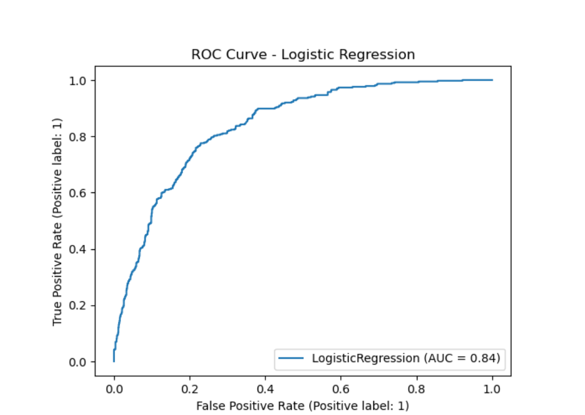
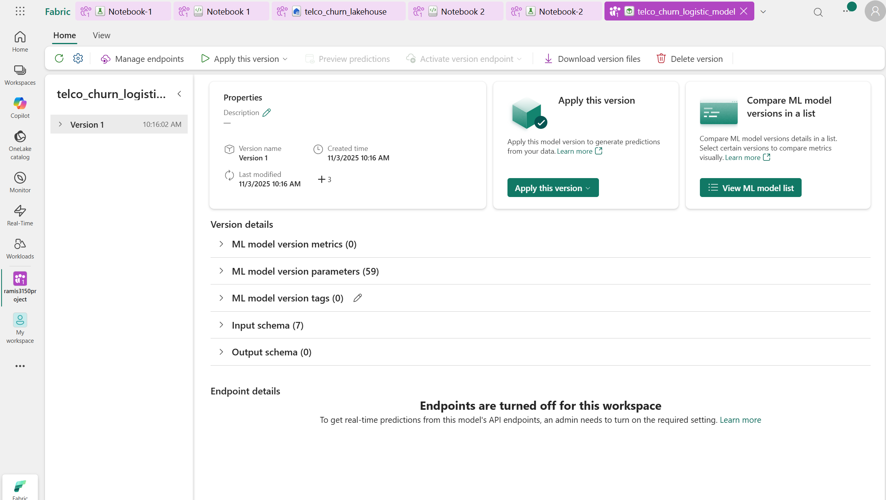
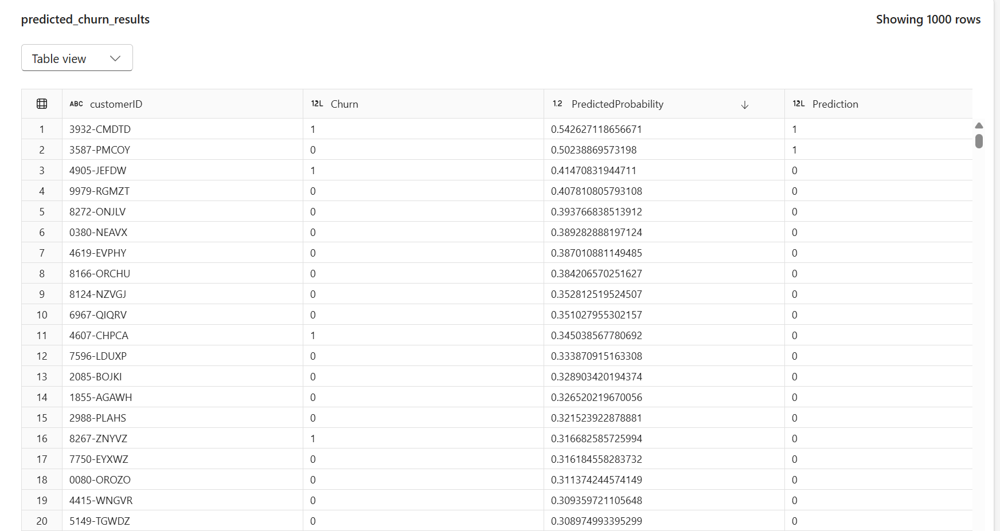

# Telco Customer Churn Analysis – Microsoft Fabric

An end-to-end churn analysis built in Microsoft Fabric: data ingestion and cleaning, exploratory analysis, a churn prediction model, and scored results saved back to the lakehouse.

## Business question
Which customers are most likely to leave, and what characteristics drive churn?

## Data
IBM Telco Customer Churn dataset: 7,043 customers with demographics, services, contract, billing, and churn status. Overall churn rate: **26.5%**.

## Pipeline
1. **Lakehouse setup:** Created a lakehouse with `raw` and `staging` folders for the source CSV.
2. **Cleaning (Dataflow Gen2 / Power Query):** Set data types, replaced missing numeric values with 0, removed the gender column, combined StreamingTV and StreamingMovies into a single Streaming flag, converted Yes/No fields to 1/0, treated "No internet service" as 0, and removed duplicate customer IDs. I used Copilot to generate transformation steps from plain-language instructions, then reviewed each step and revised prompts when results were wrong.
3. **Exploratory analysis (PySpark notebook):** Churn rates by customer segment, tenure, and charges.
4. **Modeling:** Logistic regression with an 80/20 train/test split, tracked as a Fabric experiment and saved to the model registry.
5. **Scoring:** Predicted churn probabilities written to a `predicted_churn_results` lakehouse table.

## Key findings
- **Contract type is the strongest signal:** month-to-month customers churn at 42.7% vs. 11.3% (one-year) and 2.8% (two-year).
- **Fiber optic customers churn at 41.9%**, more than double DSL (19.0%).
- **Churn falls sharply with tenure:** 47.4% in the first year vs. 9.5% after four years.
- **New, high-paying customers are the highest risk:** customers in their first year paying over $100/month churn at 76.5%.
- **Senior citizens churn at 41.7%** vs. 23.6% for non-seniors, while customers with partners or dependents churn less.
- Churned customers had an average lifetime value of $1,532 vs. $2,550 for retained customers.

## Model results
Accuracy: 80%
AUC: 0.84 
Precision (churn): 65% 
Recall (churn): 55% 

The model identifies 55% of churners in the test set. Lowering the classification threshold would catch more at-risk customers at the cost of more false positives, a trade-off that depends on how expensive retention outreach is.

## Tools
Microsoft Fabric (Lakehouse, Dataflow Gen2, Notebooks, ML experiments and model registry), Power Query, PySpark, Python (pandas, scikit-learn, matplotlib), Copilot
